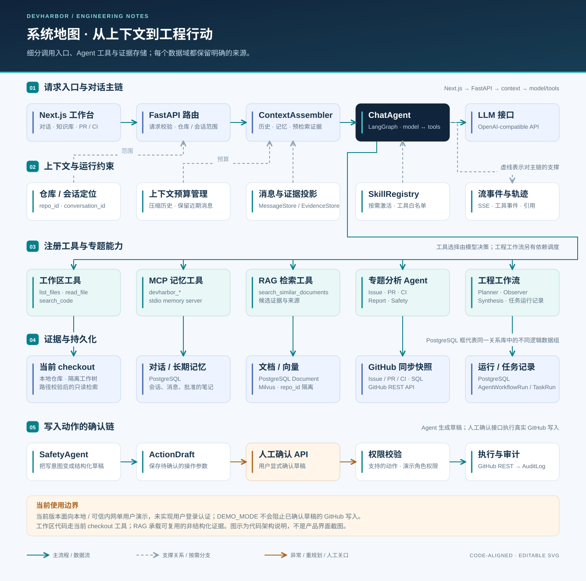

# DevHarbor 架构导读

[项目首页](README.md) · [系统设计](docs/architecture/system_design.md) · [安全边界](docs/architecture/security.md) · [运行指南](docs/guides/getting-started.md)

DevHarbor 是**面向软件研发场景的 AI 工作台**。它把问题分析、代码审查、CI 故障排查与项目知识问答放进可追溯的执行流程：先获取证据，再调用分析工具，最后给出建议或待确认的操作草稿。当前接入 GitHub 仓库数据与本地代码工作区。

系统采用 **Next.js 前端 + FastAPI 单个后端应用 + 关系数据库 / Milvus / 文件系统**。图中的节点表示代码职责边界，运行在同一后端中的 Agent 和服务并非独立微服务。

*架构示意图。图中可选模型与向量服务是否可用，取决于实际配置。*

## 先理解三个设计问题

| 问题 | 当前方案 | 实现入口 |
| --- | --- | --- |
| 如何让分析基于正确的资料？ | 当前代码读 checkout；Issue / PR / CI 状态读同步快照；历史讨论与文档走 RAG。不同来源保留各自范围和时效边界 | [三条取证路径](docs/architecture/system_design.md#三条取证路径)、[来源策略](backend/app/services/rag/source_policy.py) |
| 如何组织开放式提问与跨领域分析？ | ChatAgent 用模型选择工具；工程工作流用规则生成任务图，再做依赖调度、超时控制、观察与有限重规划 | [两层执行控制](docs/architecture/system_design.md#两层执行控制)、[ChatAgent](backend/app/services/agents/chat_agent.py)、[WorkflowOrchestrator](backend/app/services/agents/workflow_orchestrator.py) |
| 如何判断结果是否可信、操作是否执行？ | 回答保留工具事件和来源；评测区分执行结束、证据规则和模型评分；外部写入经 ActionDraft 确认接口执行并审计 | [评估边界](docs/architecture/system_design.md#检索与评估边界)、[持久化与失败语义](docs/architecture/system_design.md#持久化与失败语义) |

## 一次工程问题怎样经过系统

以“这个 PR 是否具备合并条件”为例：

1. **确定范围。** 页面传入仓库、会话和问题；API 解析范围，保留用户原文，组装有预算的历史、记忆与预检索证据。
2. **补足证据。** ChatAgent 调用工作区或检索工具，或者进入专项 PR / CI 分析；需要综合判断时调用工程工作流。
3. **执行任务图。** Planner 构造依赖，调度器运行就绪任务，Observer 检查失败、证据缺口和冲突，Synthesis 汇总判断。Planner / Observer / Synthesis 当前采用规则和结构化逻辑。
4. **返回与留痕。** HTTP / SSE 返回答案和工具事件；关系数据库保存消息、执行记录及封存 transcript。流式页面中的中间事件不等于持久化检查点。
5. **单独执行操作。** 若用户需要写入，先创建草稿；确认后调用当前支持的 GitHub 写入接口。分析工作流的计划确认与操作草稿确认是两个不同入口。

GitHub 数据反映最近一次同步，工作区反映当前 checkout。系统给出的合并建议需要结合数据新鲜度核对，并不代替 GitHub 的实时状态与合并规则。

## 阅读架构时应保留的边界

| 已实现的机制 | 当前限制与取舍 |
| --- | --- |
| 上下文分区预算、渐进压缩、原文恢复工具 | 压缩是模型输入的投影；原文与工具轨迹另行保存，Token 估算不代表实测成本收益 |
| 向量与关键词混合检索、可选重排、来源追踪 | 完整知识问答与 ChatAgent 轻量检索路径不同；降级到关键词时必须结合轨迹解读 |
| 任务依赖、超时、有限重规划 | 异步调度发生在应用进程内，没有外部持久化任务队列或重启续跑保证 |
| 操作草稿确认、执行结果与审计 | 未建立真实登录边界；`DEMO_MODE` 不阻止确认后的写入，当前适合可信本机单用户演示 |
| 回归测试、固定题集、ChatAgent + RAGAS 评测 | 隔离服务测试验证代码行为；真实模型质量需要独立、可复现的评测记录 |

## 深入实现与验证

| 阅读目标 | 文档 |
| --- | --- |
| 组件职责、调用顺序、存储与失败边界 | [系统设计与测试证据](docs/architecture/system_design.md) |
| 工具循环、任务依赖、观察与重规划 | [Agent 工作流](docs/architecture/agent_workflow.md) · [细粒度任务图](docs/assets/agent-workflow.svg) |
| 入库、混合召回、重排、门控与降级 | [RAG 流水线](docs/architecture/rag_pipeline.md) · [检索图](docs/assets/rag-pipeline.svg) |
| 实体关系、原始记录与派生数据 | [数据模型](docs/architecture/database_schema.md) |
| 测试运行、固定题集、Judge 与结果比较 | [测试与评测](docs/guides/evaluation.md) |
| Token、工作区、外部写入和部署约束 | [安全与使用边界](docs/architecture/security.md) |

代码回归入口是 [`backend/app/tests`](backend/app/tests)，自动检查定义见 [CI 工作流](.github/workflows/ci.yml)。具体断言与实现的对应关系见[系统设计中的验证表](docs/architecture/system_design.md#验证依据)。文档描述当前机制，不宣称生产准确率、性能指标或尚未实现的平台支持。
