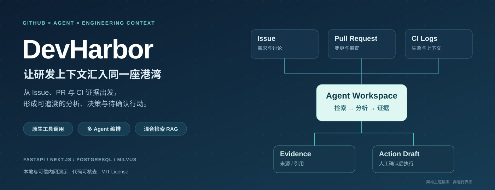
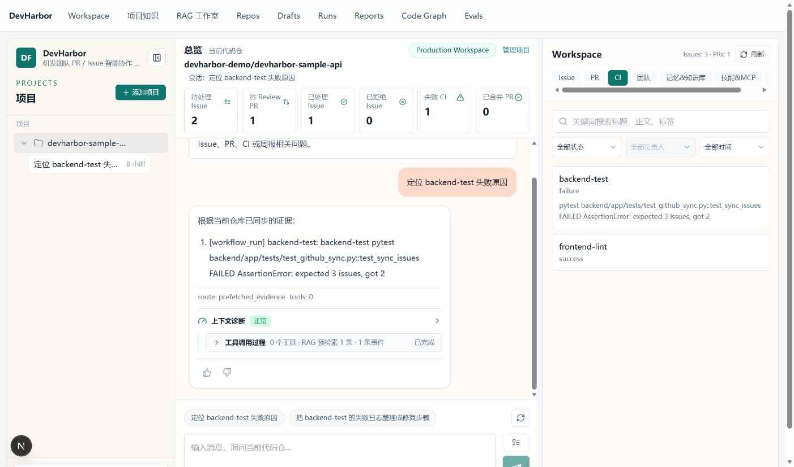
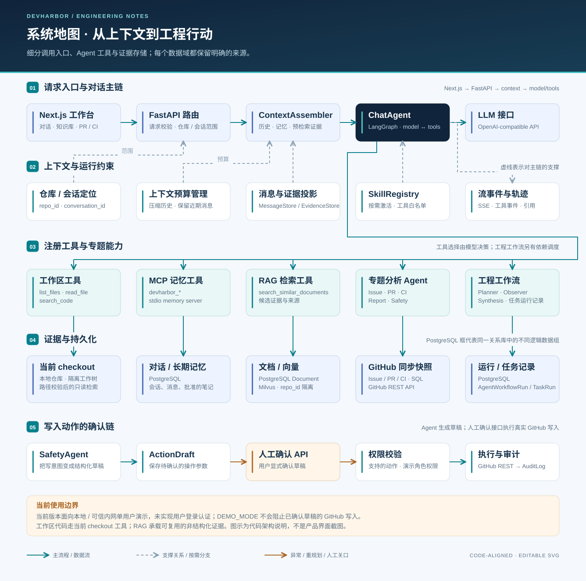
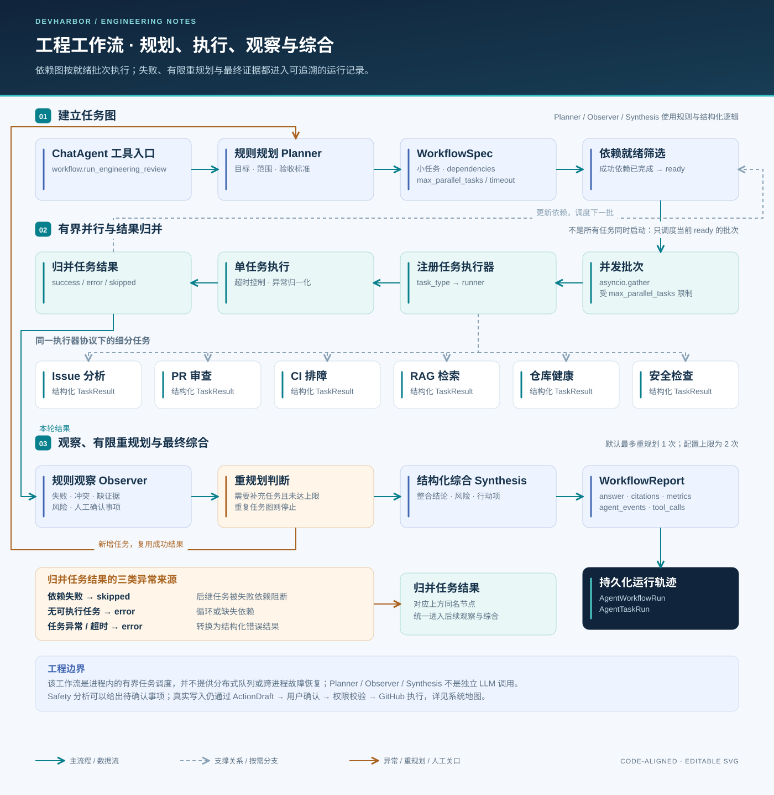
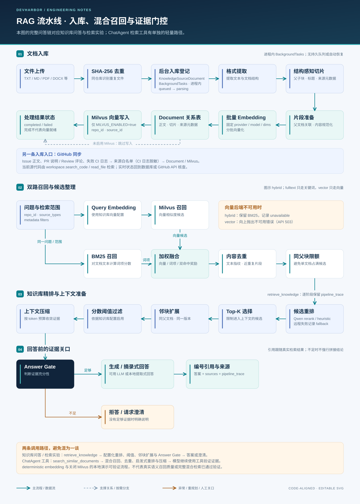

<p align="center">
  
</p>

<p align="center">
  <a href="https://github.com/ytinyx/DevHarbor/actions/workflows/ci.yml"></a>
  <a href="LICENSE"></a>
  
  
  
</p>

<p align="center">
  <a href="#项目预览">项目预览</a> ·
  <a href="#工程亮点">工程亮点</a> ·
  <a href="#架构与流程">架构与流程</a> ·
  <a href="#快速开始">快速开始</a> ·
  <a href="docs/README.md">完整文档</a> ·
  <a href="docs/guides/resume-and-interview.md">简历与面试讲解</a>
</p>

# DevHarbor | 软件研发 AI 工作台

**把问题、代码、CI 日志与项目知识，串成可追溯的工程分析流程。**

DevHarbor 是面向软件研发场景的 AI 工作台，集问题分析、代码审查、CI 故障排查与项目知识问答于一体。它结合多 Agent 编排与 RAG 检索，组织代码和文档证据，输出可追溯的分析建议，并通过人工确认执行外部操作。

当前接入 **GitHub 与本地代码工作区**：读取 Issue、PR、CI 和项目文档，并核查当前 checkout 中的代码，支持“这次变更能否合入”“CI 为什么失败”“这个需求还缺什么信息”等具体任务。GitHub 是当前协作数据与外部操作的接入实现。

当前版本适合**本机可信环境下的单用户开发与演示**。尚未实现登录认证；确认操作草稿会触发真实 GitHub 写入，`DEMO_MODE` 不会阻止写入。运行前请阅读[安全与使用边界](docs/architecture/security.md)。

## 项目预览



*真实页面截图，使用仓库自带的虚构样例数据在本地运行；未调用真实模型。封面和下方流程图为架构示意。更多页面与复现步骤见[演示说明](docs/guides/demo.md)。*

## 工程亮点

| 能力 | 具体实现 | 代码入口 |
| --- | --- | --- |
| 可观察的工具调用 | LangGraph 状态图驱动 ChatAgent，使用 LangChain 工具 schema、原生 tool-calling 与 SSE 事件；记录工具输入、输出和引用 | [chat_agent.py](backend/app/services/agents/chat_agent.py) |
| 有依赖的工程审查 | 规则 Planner 拆分任务，编排器并发执行已就绪任务，处理失败依赖和超时；Observer 可触发有限重规划，再由 Synthesis 综合结果 | [workflow_orchestrator.py](backend/app/services/agents/workflow_orchestrator.py) |
| 按数据性质选择检索 | 文档走 RAG，当前代码走工作区词法搜索/文件读取，Issue、PR、CI 状态走结构化查询；完整 RAG 问答支持向量 + BM25、重排、父上下文和引用 | [retrieval.py](backend/app/services/rag/retrieval.py) · [knowledge_base.py](backend/app/services/rag/knowledge_base.py) |
| 按需加载 Skill | 按显式指定或触发条件选择 `SKILL.md`，加载任务相关指令与受限引用资源；记录版本、激活原因和执行校验 | [registry.py](backend/app/services/skills/registry.py) |
| 长对话上下文管理 | 上下文预算、微压缩与摘要压缩；保留工具调用/结果配对和原始记录，区分模型输入与持久化历史 | [chat_memory.py](backend/app/services/chat_memory.py) · [context_compression.py](backend/app/services/context_compression.py) |
| 可回归的评估闭环 | 隔离会话运行 ChatAgent，保存题集 Hash、检索证据、工具轨迹与硬规则；支持 RAGAS 评分、异常评分重试和同基线对比 | [ragas_runner.py](backend/app/services/evals/ragas_runner.py) |

Issue 分类、PR 风险检查、CI 排障与工程周报都有独立入口。涉及写入时，SafetyAgent 先生成 ActionDraft，再由用户确认执行。规则规划/观察/综合模块与调用模型的分析模块各自承担明确职责，详见[Agent 工作流](docs/architecture/agent_workflow.md)。

## 架构与流程

### 01 · 系统模块关系



[放大查看 SVG](docs/assets/architecture.svg) · [模块职责与代码映射](docs/architecture/system_design.md)

<details>
<summary><strong>02 · 从问题到工程审查：展开执行流程</strong></summary>



[放大查看 SVG](docs/assets/agent-workflow.svg) · [控制流与失败处理](docs/architecture/agent_workflow.md)

</details>

<details>
<summary><strong>03 · 从文档到可引用的证据：展开 RAG 流程</strong></summary>



[放大查看 SVG](docs/assets/rag-pipeline.svg) · [检索链路与边界](docs/architecture/rag_pipeline.md)

</details>

图示把数据流、控制流和外部服务拆开表达。ChatAgent 的轻量检索工具与 RAG 工作室的完整问答链路分别说明；图示源文件及维护方式见[图示目录](docs/diagrams/README.md)。

## 技术栈

| 层次 | 技术与用途 |
| --- | --- |
| 界面 | Next.js 15、React 19、TypeScript、Tailwind CSS；对话、知识库、审查和评估页面 |
| API 与数据 | Python 3.11、FastAPI、Pydantic、SQLAlchemy；PostgreSQL 保存业务状态，SQLite 用于本地轻量演示和测试 |
| Agent | LangGraph、LangChain、OpenAI 兼容接口；自定义依赖任务编排、Skill Runtime、上下文管理 |
| 检索 | Milvus 向量索引、BM25、Qwen Embedding / Rerank 可选配置、启发式降级；引用与证据门控 |
| 验证与运行 | pytest、Ragas、ESLint、Next.js 构建、GitHub Actions、Docker Compose |

Compose 启动 PostgreSQL、etcd、MinIO 与 Milvus；前后端应用在本机启动。当前向量检索实现使用 **Milvus**；Compose 的 PostgreSQL 镜像包含 pgvector 扩展，但它不是当前 RAG 的向量检索后端。

## 快速开始

环境：**Python 3.11、Node.js 24**。以下是无需 Docker、无需 API Key 的 Windows 本地演示；在仓库根目录执行：

```powershell
py -3.11 -m venv backend/.venv
.\backend\.venv\Scripts\python.exe -m pip install -r backend/requirements.txt
npm --prefix frontend ci
.\scripts\start_rag.ps1
```

打开前端 **http://127.0.0.1:3000**，API 文档在 **http://127.0.0.1:8000/docs**。脚本创建独立的 SQLite 演示数据库，填入样例 Issue、PR 与 CI 数据，关闭模型调用和 Milvus。

这个模式可以体验页面、结构化分析、文档上传、关键词检索与引用展示，向量检索会显示 `degraded`。**它不能验证真实向量召回或模型回答质量。**

| 目标 | 下一步 |
| --- | --- |
| macOS / Linux 启动，或接入 PostgreSQL + Milvus | [完整安装与启动](docs/guides/getting-started.md) |
| 配置 GitHub、LLM、Embedding、Rerank | [配置说明](docs/guides/configuration.md) |
| 复现知识检索和评估演示 | [演示路线](docs/guides/demo.md) · [评估指南](docs/guides/evaluation.md) |
| 接入或调试 API | [API 导航](docs/api/openapi.md) |

`frontend/.env.local` 用于前端 API 地址配置；Next.js 不自动读取根目录 `.env`。升级已有部署前请备份数据库并保留现有卷、索引集合与配置，见[启动指南](docs/guides/getting-started.md)。

## 开发与验证

```powershell
# 在仓库根目录执行；macOS / Linux 在 backend 内使用 .venv/bin/python
Push-Location backend
.\.venv\Scripts\python.exe -m pytest app/tests -q -o asyncio_default_fixture_loop_scope=function
Pop-Location
npm --prefix frontend run lint
npm --prefix frontend run build
python scripts/validate_docs.py
```

[CI 工作流](.github/workflows/ci.yml) 包含后端依赖检查与测试、前端依赖审计、lint 和构建。自动化测试使用隔离 SQLite、确定性 Embedding 与模拟外部服务；真实模型评分和 PostgreSQL / Milvus 集成需要另外验证。[开发说明](docs/guides/development.md)列出了完整命令和图示更新流程。

## 文档导航

| 想了解什么 | 阅读入口 |
| --- | --- |
| 系统如何分层、数据如何流动 | [系统设计](docs/architecture/system_design.md) · [数据模型](docs/architecture/database_schema.md) |
| Agent 如何调用工具、调度任务 | [Agent 工作流](docs/architecture/agent_workflow.md) |
| 文档如何切片、召回、重排与引用 | [RAG 流程](docs/architecture/rag_pipeline.md) |
| 怎样安装、演示和评估 | [启动](docs/guides/getting-started.md) · [演示](docs/guides/demo.md) · [评估](docs/guides/evaluation.md) |
| 怎样介绍项目与回答技术追问 | [简历与面试讲解](docs/guides/resume-and-interview.md) |
| 安全边界与漏洞反馈 | [安全架构](docs/architecture/security.md) · [SECURITY.md](SECURITY.md) |

维护者：[小样（ytinyx）](https://github.com/ytinyx) · [版本记录](VERSIONS.md) · [MIT License](LICENSE)
