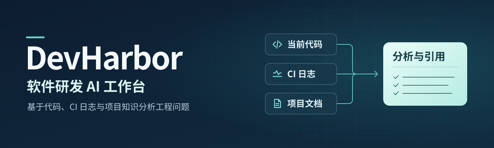
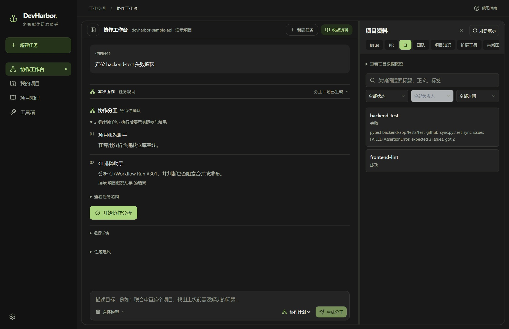
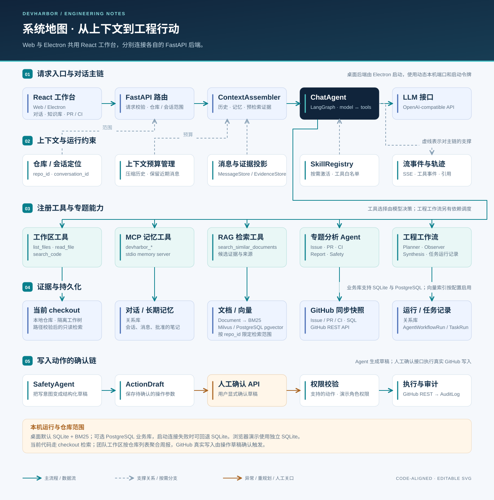
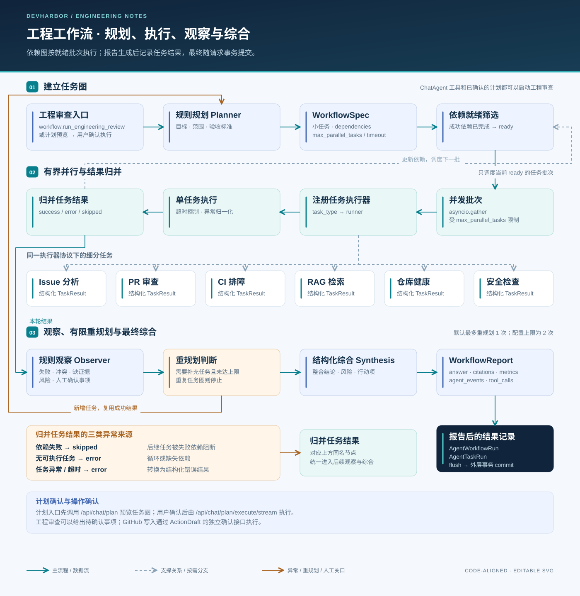
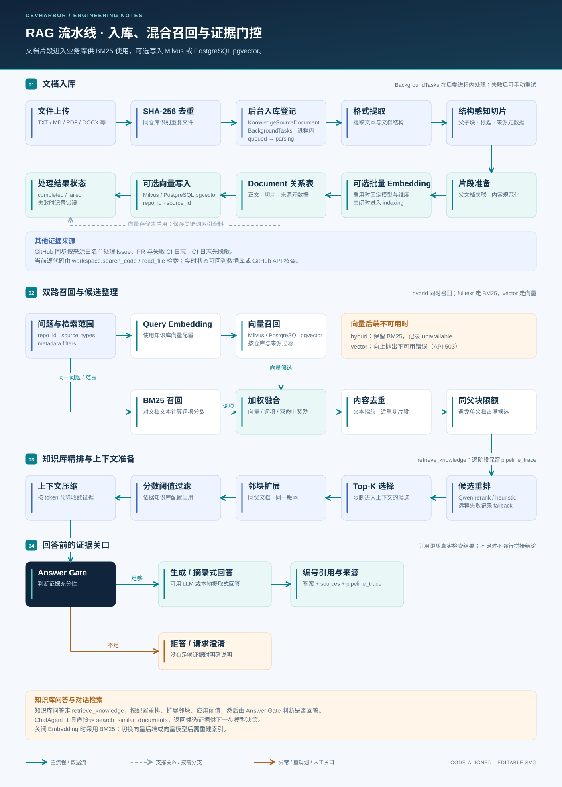

<p align="center">
  
</p>

<p align="center">
  <a href="LICENSE"></a>
  
  
  
  
</p>

<p align="center">
  <a href="#项目预览">项目预览</a> ·
  <a href="#工程亮点">工程亮点</a> ·
  <a href="#架构与流程">架构与流程</a> ·
  <a href="#项目目录">项目目录</a> ·
  <a href="#快速开始">快速开始</a> ·
  <a href="docs/README.md">完整文档</a>
</p>

# DevHarbor | 软件研发 AI 工作台

这个仓库的公开版本以现有 DevHarbor 项目为起点。

**把问题、代码、CI 日志与项目知识，串成可追溯的工程分析流程。**

DevHarbor 是面向软件研发场景的 AI 工作台，集问题分析、代码审查、CI 故障排查与项目知识问答于一体。它结合多 Agent 编排与 RAG 检索，组织代码和文档证据，输出可追溯的分析建议，并通过人工确认执行外部操作。

当前接入 **GitHub 与本地代码工作区**：读取 Issue、PR、CI 和项目文档，并核查当前 checkout 中的代码，支持“这次变更能否合入”“CI 为什么失败”“这个需求还缺什么信息”等具体任务。GitHub 是当前协作数据与外部操作的接入实现。

提供 **Electron 桌面版和浏览器版**，共用 React 界面与功能。桌面版自行启动本机 Python 后端；两种入口默认使用独立数据，**共享代码不等于自动同步项目、会话或密钥**。详见[桌面运行指南](docs/guides/desktop.md)。

当前版本适合**本机可信环境下的单用户开发与演示**。浏览器版尚未提供用户登录；桌面托管后端使用独立的本机会话令牌。确认操作草稿会触发真实 GitHub 写入，`DEMO_MODE` 不会阻止写入。运行前请阅读[安全与使用边界](docs/architecture/security.md)。

## 项目预览



*本地演示的真实页面。图中展示的是样例 CI 故障的分工计划，等待用户确认执行。*

[查看知识问答截图与复现步骤](docs/guides/demo.md)

## 工程亮点

| 能力 | 具体实现 | 代码入口 |
| --- | --- | --- |
| 可观察的工具调用 | LangGraph 状态图驱动 ChatAgent，使用 LangChain 工具 schema、原生 tool-calling 与 SSE 事件；记录工具输入、输出和引用 | [chat_agent.py](backend/app/services/agents/chat_agent.py) |
| 有依赖的工程审查 | 规则 Planner 拆分任务，编排器并发执行已就绪任务，处理失败依赖和超时；Observer 可触发有限重规划，再由 Synthesis 综合结果 | [workflow_orchestrator.py](backend/app/services/agents/workflow_orchestrator.py) |
| 按数据性质选择检索 | 文档走 RAG，当前代码走工作区词法搜索/文件读取，Issue、PR、CI 状态走结构化查询；完整 RAG 问答支持向量 + BM25、重排、父上下文和引用 | [retrieval.py](backend/app/services/rag/retrieval.py) · [knowledge_base.py](backend/app/services/rag/knowledge_base.py) |
| 按需加载 Skill | 按显式指定或触发条件选择 `SKILL.md`，加载任务相关指令与受限引用资源；记录版本、激活原因和执行校验 | [registry.py](backend/app/services/skills/registry.py) |
| 长对话上下文管理 | 上下文预算、微压缩与摘要压缩；保留工具调用/结果配对和原始记录，区分模型输入与持久化历史 | [chat_memory.py](backend/app/services/chat_memory.py) · [context_compression.py](backend/app/services/context_compression.py) |
| 可回归的评估闭环 | 隔离会话运行 ChatAgent，保存题集 Hash、检索证据、工具轨迹与硬规则；支持 RAGAS 评分、异常评分重试和同基线对比 | [ragas_runner.py](backend/app/services/evals/ragas_runner.py) |

Issue 分类、PR 风险检查、CI 排障与工程周报都有独立入口。涉及写入时，SafetyAgent 先生成 ActionDraft，再由用户确认执行。规则规划/观察/综合模块与调用模型的分析模块各自承担明确职责，详见[Agent 工作流](docs/architecture/agent_workflow.md)。

## 架构与流程

### 01 · 系统模块关系



[放大查看 SVG](docs/assets/diagrams/architecture.svg) · [模块职责与代码映射](docs/architecture/system_design.md)

<details>
<summary><strong>02 · 从问题到工程审查：展开执行流程</strong></summary>



[放大查看 SVG](docs/assets/diagrams/agent-workflow.svg) · [控制流与失败处理](docs/architecture/agent_workflow.md)

</details>

<details>
<summary><strong>03 · 从文档到可引用的证据：展开 RAG 流程</strong></summary>



[放大查看 SVG](docs/assets/diagrams/rag-pipeline.svg) · [检索链路与边界](docs/architecture/rag_pipeline.md)

</details>

图示把数据流、控制流和外部服务拆开表达。ChatAgent 的轻量检索工具与 RAG 工作室的完整问答链路分别说明；图示源文件及维护方式见[图示目录](docs/diagrams/README.md)。

## 技术栈

| 层次 | 技术与用途 |
| --- | --- |
| 界面 | React 19、Vite 8、React Router、TypeScript、Tailwind CSS；浏览器和桌面共用页面 |
| 桌面 | Electron；管理本机后端进程，通过受限桥接提供运行配置；Python 后端可随应用冻结打包 |
| API 与数据 | Python 3.11、FastAPI、Pydantic、SQLAlchemy；桌面默认 SQLite，也可连接 PostgreSQL。浏览器完整环境可使用 PostgreSQL，本地演示使用 SQLite |
| Agent | LangGraph、LangChain、OpenAI 兼容接口；自定义依赖任务编排、Skill Runtime、上下文管理 |
| 检索 | Milvus 或 PostgreSQL（pgvector）向量存储、BM25、Qwen Embedding / Rerank 可选配置；引用与证据门控 |
| 验证与运行 | pytest、Ragas、ESLint、Vite 构建、Node 桌面运行测试、GitHub Actions、Docker Compose |

前后端应用在本机启动。向量存储可在「设置 → 检索模型」中选择 Milvus 或 PostgreSQL（pgvector）。只用 pgvector 时，可以单独启动 Compose 的 `postgres` 服务。桌面版默认使用 SQLite，也可在「数据库连接」中配置 PostgreSQL。

## 项目目录

| 目录 | 从哪里开始 |
| --- | --- |
| [`frontend/`](frontend/) | 改页面从 `app/` 开始，找共用组件看 `components/`，桌面进程代码在 `electron/` |
| [`backend/`](backend/) | FastAPI 在 `app/main.py` 启动，Agent 与检索代码在 `app/services/`，回归用例在 `app/tests/` |
| [`scripts/`](scripts/) | 启动本地浏览器演示、初始化数据、检查 GitHub 连接，以及生成和校验文档图表 |
| [`docs/`](docs/) | 使用指南、架构说明、接口、示例和图表 |

[打开详细目录图](docs/diagrams/00_打开图表.html) · [查看目录概览 SVG](docs/assets/diagrams/project-layout.svg) · [按任务查找源码、测试和配置](docs/guides/project-layout.md)

## 快速开始

环境：**Python 3.11、Node.js 24**。源码运行前，在仓库根目录安装依赖：

```powershell
py -3.11 -m venv backend/.venv
.\backend\.venv\Scripts\python.exe -m pip install -r backend/requirements.txt
npm --prefix frontend ci
```

启动桌面开发版：

```powershell
npm --prefix frontend run desktop:dev
```

该命令自动启动 Vite、Electron 和桌面专属后端。首次进入后连接项目，在左下角齿轮的「API 配置」中填写模型供应商。桌面数据与浏览器演示库分开，原浏览器密钥需要在桌面中重新填写；默认使用 BM25 关键词检索，不下载语义模型。

如需在浏览器体验无需 Docker、无需 API Key 的样例数据：

```powershell
.\scripts\start_rag.ps1
```

打开[本地工作台](http://127.0.0.1:5174)，API 文档在[本地 Swagger UI](http://127.0.0.1:8000/docs)。脚本创建独立的 SQLite 演示数据库，填入样例 Issue、PR 与 CI 数据，关闭模型调用和 Milvus。

这个模式可以体验页面、结构化分析、文档上传、关键词检索与引用展示，向量检索会显示 `degraded`。**它不能验证真实向量召回或模型回答质量。**

| 目标 | 下一步 |
| --- | --- |
| 桌面开发、静态桌面运行或 Windows 打包 | [桌面运行与打包](docs/guides/desktop.md) |
| macOS / Linux 启动，或接入 PostgreSQL + Milvus | [完整安装与启动](docs/guides/getting-started.md) |
| 配置 GitHub、LLM、Embedding、Rerank | [配置说明](docs/guides/configuration.md) |
| 复现知识检索和评估演示 | [演示路线](docs/guides/demo.md) · [评估指南](docs/guides/evaluation.md) |
| 接入或调试 API | [API 导航](docs/api/openapi.md) |

浏览器版在 `frontend/.env.local` 中用 `VITE_API_BASE_URL` 配置 API 地址，默认 `http://127.0.0.1:8000`；Vite 不自动读取根目录 `.env`。桌面版通过桥接取得动态本机端口，不使用这个浏览器地址。静态托管 `frontend/dist` 时需配置 SPA 路由回退。升级前请备份各入口的数据，见[启动指南](docs/guides/getting-started.md)。

## 开发与验证

```powershell
# 在仓库根目录执行；macOS / Linux 在 backend 内使用 .venv/bin/python
Push-Location backend
.\.venv\Scripts\python.exe -m pytest app/tests -q -o asyncio_default_fixture_loop_scope=function
Pop-Location
npm --prefix frontend run lint
npm --prefix frontend run test:desktop
npm --prefix frontend run build
python scripts/documentation-tools/validate_docs.py
```

[CI 工作流](.github/workflows/ci.yml) 包含后端依赖检查与测试、前端依赖审计、lint、桌面运行模块测试和 Vite 构建。桌面模块测试不启动 Electron 图形窗口，也不等于安装包验收。自动化测试使用隔离 SQLite、确定性 Embedding 与模拟外部服务；真实模型评分和 PostgreSQL / Milvus 集成需要另外验证。[开发说明](docs/guides/development.md)列出了更多命令和图示更新流程。

## 文档导航

完整详细图可从 [离线图集](docs/diagrams/00_打开图表.html) 或 [15 张图索引](docs/diagrams/README.md) 进入。

| 想了解什么 | 阅读入口 |
| --- | --- |
| 系统如何分层、数据如何流动 | [架构导读](docs/architecture/README.md) · [系统设计](docs/architecture/system_design.md) · [数据模型](docs/architecture/database_schema.md) |
| Agent 如何调用工具、调度任务 | [Agent 工作流](docs/architecture/agent_workflow.md) |
| 文档如何切片、召回、重排与引用 | [RAG 流程](docs/architecture/rag_pipeline.md) |
| 怎样安装、演示和评估 | [启动](docs/guides/getting-started.md) · [桌面版](docs/guides/desktop.md) · [演示](docs/guides/demo.md) · [评估](docs/guides/evaluation.md) |
| 安全边界与漏洞反馈 | [安全架构](docs/architecture/security.md) · [SECURITY.md](SECURITY.md) |

[版本记录](CHANGELOG.md) · [MIT License](LICENSE)
