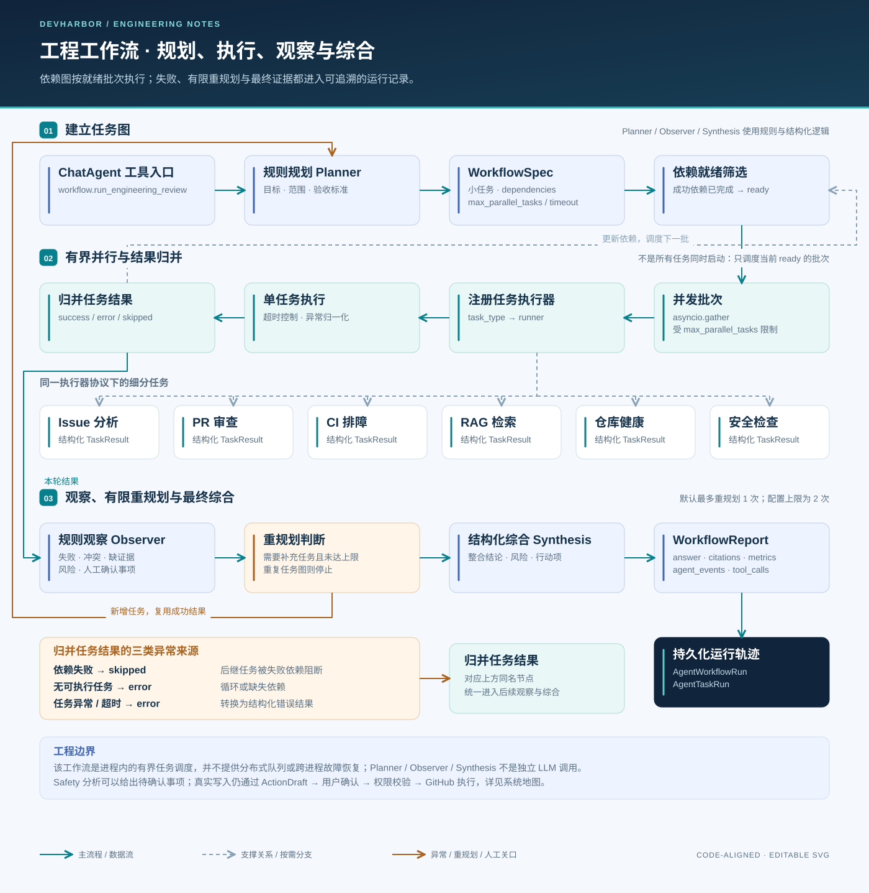

# 对话与工程工作流

[返回首页](../../README.md) · [系统架构](system_design.md) · [RAG 流水线](rag_pipeline.md) · [安全边界](security.md)

DevHarbor 有两层控制流：`ChatAgent` 用模型的工具调用能力逐步取证；`WorkflowOrchestrator` 在需要跨领域分析时执行一个有边界的任务图。两层共享专项工具，但职责和执行方式不同。

*架构示意图。Planner / Observer / Synthesis 为规则与结构化逻辑；图中并行关系表示依赖满足后的调度机会，不表示所有任务一定同时执行。*

## 两层控制流各自负责什么

| 维度 | ChatAgent | WorkflowOrchestrator |
| --- | --- | --- |
| 谁决定下一步 | LLM 返回工具调用或最终回答，LangGraph 执行控制循环 | Planner 按目标和可用数据构造任务图，调度器按依赖推进 |
| 执行单元 | 服务端注册表中一个 `StructuredTool` | `WorkflowTask`，经 `task_type` 映射到服务端 runner |
| 并发方式 | 同一轮待执行工具按队列逐个处理 | 同一批就绪任务用 `asyncio.gather` 执行，等整批结束再调度下一批 |
| 结果 | 回答、引用、工具事件、`completion` | 任务结果、Observer 发现、Synthesis 报告与指标 |
| 交汇点 | 可调用 `workflow.run_engineering_review` | 报告作为一次工具观察回到 ChatAgent；也可由计划执行 API 直接调用 |

这种划分把开放式取证与可检查的依赖调度分开。LangGraph 管理对话循环；跨领域工作流是本项目自己的 Python 调度器，并非另一套 LangGraph 子图。Planner、Observer、Synthesis 本身采用规则与结构化逻辑，专项分析 Agent 才按各自实现调用模型或规则。

## 1. 请求进入模型之前

[`api/routes/chat.py`](../../backend/app/api/routes/chat.py) 接收仓库与会话范围，依次完成：

| 阶段 | 小模块 | 处理结果 |
| --- | --- | --- |
| 范围解析 | `_repo_or_404`、`ensure_conversation` | 确定当前仓库与会话，避免只依赖模型传入的范围 |
| 空间预留 | `ProgressiveContextManager.ensure_headroom` | 根据上下文压力决定是否压缩；记录压缩边界与恢复线索 |
| 保存原始输入 | `MessageStore.append` | 保存用户消息，保留可追溯原文 |
| 更新证据投影 | `EvidenceStore.rebuild_repo` | 准备当前范围可读取的项目、历史与记忆证据 |
| 组装输入 | `ContextAssembler.assemble` | 合并系统信息、结构化记忆、会话摘要、近期消息和预检索证据 |
| 工具与 Skill | `_build_conversation_tools`、`SkillRegistry` | 绑定服务端工具、激活 Skill 并注入本次需要的指令 |

原始问题先用于一次预检索；进入模型循环后，模型仍可改写查询、多次调用检索工具。近期历史和项目概览也有专门的快速路径，不必每次都完整经过通用工具循环。

## 2. ChatAgent：模型决策与工具观察

实现位于 [`chat_agent.py`](../../backend/app/services/agents/chat_agent.py)。`ChatOpenAI` 绑定 `StructuredTool`，LangGraph 维护三个控制节点：

| 节点 | 输入 | 后继 |
| --- | --- | --- |
| `model_decision` | 当前消息、上下文、已有工具观察 | 有 tool calls → `tool_action`；已有最终回答 → 结束 |
| `tool_action` | 一个待执行的工具调用 | 有剩余 tool calls → 继续执行；否则回到模型或检查步数上限 |
| `max_steps_stop` | 已完成的工具结果 | 返回预算耗尽说明，结束本轮 |

执行工具前会规范化名称与参数，检查显式 Skill 的工具边界；执行后记录 `tool_use`、`tool_result`、观察与引用。可恢复的部分异常会触发有限重试；未知工具、权限问题和一般执行失败都保留结构化错误类型。

工具来自 `chat.py` 的服务端注册表，再由 `_build_langchain_tools` 包装为 `StructuredTool`；名称映射和参数 schema 让模型提出调用，具体函数及仓库、会话上下文仍由服务端绑定。显式 Skill 可以进一步约束可用工具，但这些约束不构成用户身份鉴权。

当前代码设置 `max_steps = 12`，统计的是模型决策轮次；同一名称与参数的工具调用重复上限为 `2`。工具失败最多额外尝试 `1` 次，具体策略如下：

| 触发情况 | 处理与边界 |
| --- | --- |
| 工具超时、限流、临时网络错误 | 可重试一次；安全草稿、周报、整个工程工作流三个工具不走该自动重试分支 |
| 未知工具、权限不足、资料缺失或一般运行错误 | 记录结构化错误观察，供后续决策使用；不是所有错误都会自动重试 |
| 模型上下文溢出 | 仅对失败的模型调用做一次更强的运行时上下文压缩后重试；不重放已执行工具 |
| 其他通用模型调用异常 | 向 API 层传播；流式路由记录错误回答和失败运行，不保证生成替代分析 |
| 没有模型配置 | 历史、项目概览或预检索路径可返回已有证据；不能据此认定完成模型推理 |
| 重复工具调用或决策预算耗尽 | 终止循环，返回 `blocked` 或 `budget_exhausted` 等完成状态 |

这些上限控制调用预算，不是总耗时保证。`completion.status`、`reason`、`tool_error_count` 与工具事件共同说明实际完成程度；有回答文本，甚至数据库中的 `AgentRun.status = success`，也不代表所有工具成功或结论可靠。

## 3. 工具分组与证据去向

| 工具 | 实际读取或产生的内容 |
| --- | --- |
| `workspace.list_files` / `read_file` / `search_code` | 当前仓库工作区中的文件与词法匹配，不通过向量召回猜测源码 |
| `devharbor_search_evidence` | 通过 stdio MCP 检索当前范围内的证据 |
| `devharbor_get_thread_context` | 通过 stdio MCP 读取会话上下文与原始消息 |
| `devharbor_read_session_events` | 通过 stdio MCP 读取封存会话的事件与 transcript |
| `rag.search_similar_documents` | 历史 Issue / PR / 失败日志 / 文档等候选证据；见 [RAG 两类入口](rag_pipeline.md) |
| `repo_health.generate_summary` | 从同步快照汇总仓库健康信息 |
| `issue_agent.analyze_issue` | 分类、优先级、复杂度、负责人建议、重复候选和行动项 |
| `pr_review_agent.analyze_pr` | 基于 diff 等输入的摘要、风险、分级问题和测试建议 |
| `ci_debug_agent.analyze_workflow_run` | 失败类型、可能根因、排查步骤和门禁判断 |
| `report_agent.generate_weekly_report` | 指定窗口内的工作总结 |
| `safety_agent.classify_action_risk` | 风险判断与操作草稿，不在此直接执行 GitHub 写入 |
| `workflow.run_engineering_review` | 进入下述跨领域工程工作流 |

## 4. 工程工作流：从计划到报告

1. **规则规划。** `PlannerAgent` 根据目标文字、可用 Issue / PR / CI、是否需要历史证据与写入审查，构造 `WorkflowSpec`。每项任务包含 `task_type`、目标、`claim`、依赖和输入提示。
2. **依赖检查。** 调度器维护 `pending`、成功结果和失败依赖集合；已成功的任务在重规划后可复用。依赖失败的任务标为 `skipped`；缺失依赖或环导致无法推进时记录错误。
3. **有界执行。** 只选择依赖全部成功的任务，以 `max_parallel_tasks` 为批次上限，通过 `asyncio.gather` 执行。每个任务由 `asyncio.wait_for` 施加超时；结果统一为 `WorkflowTaskResult`。
4. **规则观察。** `ObserverAgent` 汇总失败/跳过、证据缺失、低置信度、CI 门禁、PR 阻塞项、跨 Agent 冲突及人工确认需求。
5. **有限重规划。** 对可修复发现调用 `PlannerAgent.replan`；默认最多一次，参数限制最多两次，计划没有改变时终止。这里是补充或调整任务图，不保证问题一定修复。
6. **结构化综合。** `SynthesisAgent` 保留阻塞项和观察结论，生成决策、依据与下一步。
7. **持久化。** 报告返回 API 层后，由 `_persist_engineering_workflow` 写入 `AgentWorkflowRun` 和 `AgentTaskRun`，随当前请求事务提交；记录目标、规格、各任务输入输出、状态与耗时等指标。

典型依赖是 `repo_health → PR / Issue / CI / RAG`；是否创建某条分支取决于目标和可用数据。安全审查在有写入意图时被选入。**工作流计划中的 `claim` 用于明确任务范围，不替代服务端鉴权或进程隔离。**

计划还可经 `/api/chat/plan` 展示，再由 `/api/chat/plan/execute/stream` 执行。这是工作流计划入口，与 GitHub 操作草稿的确认入口不同。当前计划执行 API 直接调用 `run_spec`，仍使用默认的有限重规划策略；不能将“确认计划”理解成任务图绝不会增补。

调度参数与失败状态见 [`WorkflowSpec`](../../backend/app/schemas/workflow.py) 和 [`workflow_orchestrator.py`](../../backend/app/services/agents/workflow_orchestrator.py)：并行批次默认上限为 3，schema 允许 1–8；单任务超时默认 90 秒，可由配置调整。超时记为 `error / timeout`，依赖失败记为 `skipped / dependency_failed`，缺失或循环依赖记为 `error / dependency_cycle_or_missing`。观察器仍可综合已取得的结果；数据库中的工作流 `status` 由任务错误计数决定，不直接表示 Observer 已允许合并。执行是否成功与“可以合并”的业务判断必须分开看。

`asyncio.wait_for` 限制可协作取消的任务等待；runner 中的同步阻塞操作没有因此获得进程级强制终止能力。当前也没有覆盖整个请求的统一截止时间，或跨进程的任务取消、恢复协议。

## 5. 回答与记忆的闭环

回答结束后保存 assistant 消息与 `AgentRun`。`SessionSealer` 将本轮 transcript、工具事件和摘要封存为 `ChatSession`，更新结构化记忆，并可捕获待审核的记忆候选。压缩后仍保留原始记录和恢复工具线索；压缩摘要不能替代原始证据。

`ConversationMemory` 面向具体会话，`ThreadMemory` 保留仓库范围的兼容路径。长期记忆候选进入检索知识前需要相应确认流程；普通聊天历史和会话摘要不作为所有查询都可召回的向量文档。

### 记录、流式展示与恢复的边界

| 记录或信号 | 何时产生 | 可以据此判断什么 |
| --- | --- | --- |
| 用户消息与证据投影 | 模型调用前提交 | 请求输入可保留；之后失败可能只有输入、没有完整结果 |
| ChatAgent 的 `tool_use` / `tool_result` | 工具开始前 / 工具返回后发往 SSE | 可观察工具进度；事件传输本身不是逐条持久化日志 |
| 计划执行的任务轨迹 | `run_spec` 返回整份报告后整理并发往 SSE | 可回看任务关系与结果；不是每个任务的实时启动通知 |
| assistant、`AgentRun`、封存 session | 完整结果处理时提交；SSE 的 `final` 在提交后发送 | 查询已保存回答、事件和记忆投影 |
| `AgentWorkflowRun` / `AgentTaskRun` | 报告生成后加入请求事务 | 查询已落库任务报告；不是运行中任务的持久队列 |

流式路由捕获普通异常后回滚当前未提交事务，再保存错误回答；此前已提交的用户消息不会一起撤回。LangGraph 当前未配置持久 checkpointer，工作流任务图也在进程内运行。连接中断、请求取消或进程退出时，没有统一的“补存全部中间事件并从原任务位置继续”机制；应先检查历史与运行记录，再决定是否重新发起请求。数据库回滚也不能撤销已发生的外部操作，写入流程见下一节。

## 6. 写入路径与使用边界

模型分析只生成建议或草稿。`POST /api/action-drafts/{draft_id}/confirm` 才会执行支持的 GitHub 操作，成功记录 `executed`，异常记录 `failed`，并保存审计信息。当前演示权限通过本地演示用户解析，尚未实现真实登录；**人工确认流程不等于生产级身份认证**。详见[安全与使用边界](security.md)。

## 对照实现与回归测试

| 行为 | 代码或测试 |
| --- | --- |
| 工具循环、事件、预算与错误 | [`chat_agent.py`](../../backend/app/services/agents/chat_agent.py)、[`test_chat_agent.py`](../../backend/app/tests/test_chat_agent.py) |
| 计划、并发批次、超时、失败依赖与重规划 | [`workflow_orchestrator.py`](../../backend/app/services/agents/workflow_orchestrator.py)、[`test_workflow_orchestrator.py`](../../backend/app/tests/test_workflow_orchestrator.py) |
| Skill 载入与约束 | [`registry.py`](../../backend/app/services/skills/registry.py)、[`test_skill_registry.py`](../../backend/app/tests/test_skill_registry.py) |
| 上下文压缩与证据投影 | [`chat_memory.py`](../../backend/app/services/chat_memory.py)、[`test_context_compression.py`](../../backend/app/tests/test_context_compression.py)、[`test_context_memory_projection.py`](../../backend/app/tests/test_context_memory_projection.py) |

测试中可重点查看 `test_context_overflow_retries_only_the_failed_model_call`、`test_chat_agent_streams_tool_use_before_tool_finishes`、`test_orchestrator_times_out_stuck_task` 和 `test_orchestrator_marks_dependents_skipped_when_dependency_fails`。这些用例验证控制路径；替身模型与异步测试任务不代表真实服务的延迟、模型质量或进程崩溃恢复能力。
