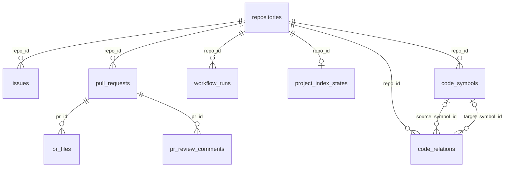
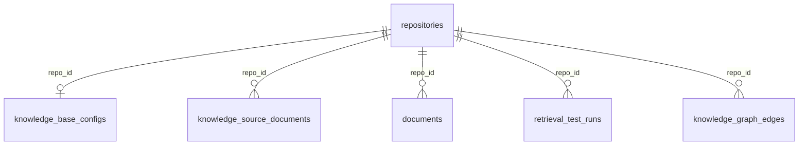
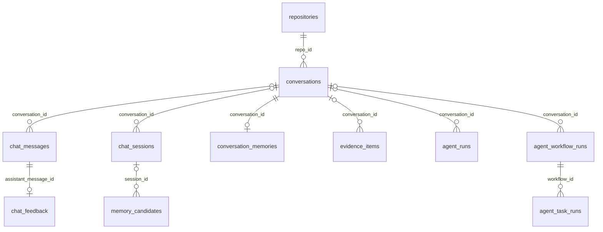

# 数据模型与持久化边界

[返回首页](../../README.md) · [系统架构](system_design.md) · [Agent 工作流](agent_workflow.md) · [RAG 流水线](rag_pipeline.md)

实体定义以 [`backend/app/db/models.py`](../../backend/app/db/models.py) 为准。关系数据库保存业务对象、文本证据和执行记录；Milvus 保存向量副本；文件系统保存 checkout 与上传原件。下面按阅读目的拆分关系图，避免把所有实体挤在一张大图中。

## 1. GitHub 快照与项目索引

| 表 | 关键内容 | 阅读要点 |
| --- | --- | --- |
| `repositories` | 仓库标识、provider、API/clone 地址、checkout 模式、加密 Token、同步时间 | `full_name` 唯一；`last_sync_at` 用于判断快照新鲜度 |
| `issues` | number、正文、状态、labels、assignees、GitHub 时间 | 标签与负责人是 JSON 字段 |
| `pull_requests` | 分支、正文、状态、合并时间 | 文件与评论单独保存 |
| `pr_files` / `pr_review_comments` | patch、增删行数 / 评论、文件路径、行号 | 作为 PR 分析上下文；并非完整 Git 历史 |
| `workflow_runs` | status、conclusion、jobs、logs_text | `jobs` JSON 包含 Job / Step 信息 |
| `project_index_states` | 状态、fingerprint、索引统计、错误摘要 | 每个仓库至多一条记录 |
| `code_symbols` / `code_relations` | 文件、符号、行号、分支、PR 范围与关系 | `pr_id` 是普通 UUID 字段，未声明到 PR 表的外键；关系两端允许为空 |

`analysis_results` 用 `target_type + target_id` 关联 Issue / PR / CI 等对象，保存输入快照、结构化分析和模型名；这是**应用层的多态关联**，不是数据库外键。`workspaces.repo_ids` 则是 JSON 中的一组仓库 ID，不是多对多中间表。

## 2. 知识与检索

| 表或存储 | 保存内容 | 与其他模块的关系 |
| --- | --- | --- |
| `knowledge_base_configs` | Embedding 契约、检索方式、重排、Top-K、阈值和分块设置 | `repo_id` 唯一 |
| `knowledge_source_documents` | 原文件位置、checksum、类型、大小、处理状态和错误 | 可定位上传原件与处理进度 |
| `documents` | `source_type`、`source_id`、标题、内容与 `metadata` | 上传片段通过来源标识关联原文；不是外键 |
| Milvus collection | 向量、`repo_id`、`document_id`、来源和元数据 | `document_id` 对应关系表文档，跨存储没有数据库外键 |
| `retrieval_test_runs` | 查询、检索参数、结果 JSON 和耗时 | 供检索实验复查 |
| `knowledge_graph_edges` | 知识对象之间的关系和元数据 | 与源码符号图的 `code_relations` 分开存储 |

`documents.metadata` 可包含路径、标题、页码、父子片段、checksum、分支、时间以及 Embedding 信息。模型中的 Python 属性为 `meta`，数据库列名为 `metadata`。当前 `documents` 表**没有 embedding 列**；不要将 PostgreSQL 的 pgvector 扩展描述成正在使用的向量后端。

## 3. 会话、记忆与执行轨迹

*图中可选父关系对应可空外键，主要用于兼容无显式会话范围的记录；它不表示可以跨仓库读取。为保持可读性，这张图省略了各表重复的 `repo_id` 外键。*

| 表 | 职责与关键字段 |
| --- | --- |
| `conversations` | 用户可见会话：标题、状态、消息计数和更新时间 |
| `chat_messages` | 原始 user / assistant 消息、route、tool_calls 和运行元数据 |
| `chat_sessions` | 一次交互封存后的 transcript、digest 和封存状态；消息 ID 字段是普通 UUID，并非 FK |
| `conversation_memories` | 会话范围的 facts、decisions、tasks、偏好、仓库上下文与 citations |
| `thread_memories` | 仓库范围的兼容记忆；`repo_id` 可空且唯一 |
| `evidence_items` | 用于上下文组装的证据投影，带范围、来源、正文和元数据 |
| `memory_candidates` | 从 session 提取的待审核记忆候选 |
| `recall_events` | 记录检索或记忆召回过程，便于追踪来源 |
| `agent_runs` | 单次对话执行的用户输入、route、tool_calls、最终回答和状态 |
| `agent_workflow_runs` | 工程工作流目标、完整规格、Observer 输出、报告和 metrics |
| `agent_task_runs` | 单项任务的 claim、输入、结果、状态、错误与起止时间 |
| `chat_feedback` | 对指定 assistant 消息的评价与反馈；可关联 AgentRun 和用户 |

`AgentRun.status` 不能单独代表所有工具成功：回答可能带有降级、工具错误或预算耗尽。排障时应同时读取消息元数据、工具事件和对应工作流任务结果。

## 4. 草稿、审计与评测

| 表 | 用途 | 关联方式 |
| --- | --- | --- |
| `users` | 演示用户、role 与加密 GitHub Token | 当前不是完整登录身份系统 |
| `action_drafts` | 待确认内容、风险、状态、确认人、执行结果或错误 | `repo_id`、`created_by`、`confirmed_by` 为 FK；目标采用类型 + ID |
| `audit_logs` | 操作、目标、请求/结果 JSON、状态、时间 | 可关联仓库和用户；目标 ID 为普通字符串 |
| `eval_runs` | 评测结果、进度、配置、逐题证据、指标和报告 | 主要内容位于 `result_json`，没有独立 `repo_id` 外键列 |

具体确认权限与 GitHub 写入行为见[安全文档](security.md)，评测状态及分数解释见[评测指南](../guides/evaluation.md)。

## 5. 维护约束

- **建表与迁移。** 当前启动过程调用 `Base.metadata.create_all`，并执行有限的兼容字段修补。它不是一套完整的版本化数据库迁移；升级前应备份并检查实际 schema。
- **删除与清理。** 部分 ORM 关系带 `delete-orphan`，其他关联由路由/服务显式清理，不能假设每条逻辑关系都具备级联删除。相关回归包括 [`test_repo_deletion.py`](../../backend/app/tests/test_repo_deletion.py) 与 [`test_conversation_deletion.py`](../../backend/app/tests/test_conversation_deletion.py)。
- **跨存储一致性。** PostgreSQL、Milvus 和本地文件之间没有统一事务；重建索引、删除和失败恢复需分别核对各层状态。
- **仓库范围。** 关系查询和向量过滤使用 `repo_id`；部分历史记录允许空范围。它是应用层范围控制，不等同于多租户授权系统。
- **持久化兼容。** 稳定来源 UUID 的历史命名空间应保持兼容；调整文件名、集合名或来源类型时，不应仅凭文档名称改动就重建所有标识。
