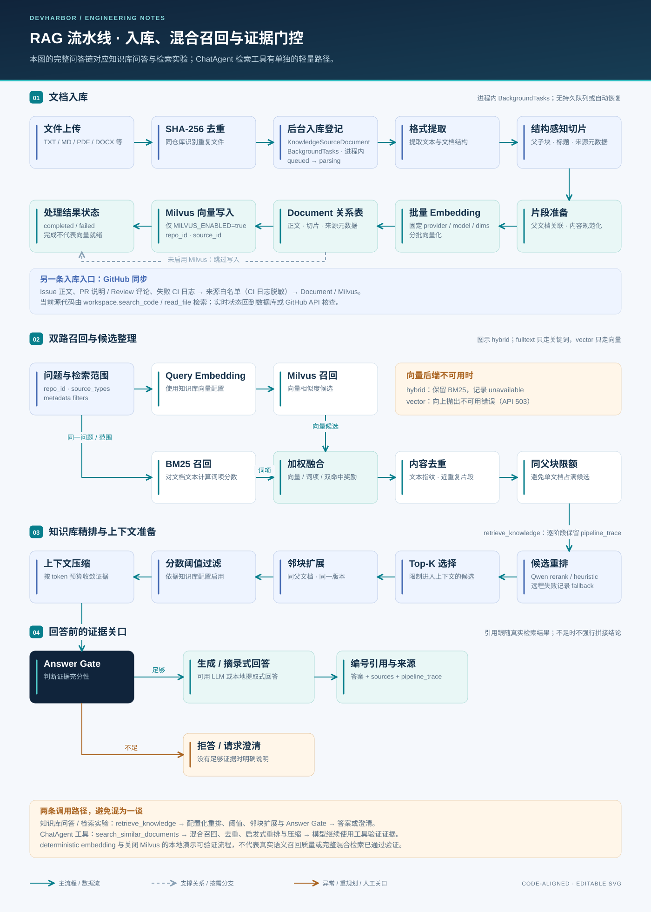

# RAG：从项目资料到可核对的证据

[返回首页](../../README.md) · [系统架构](system_design.md) · [Agent 工作流](agent_workflow.md) · [配置指南](../guides/configuration.md) · [评测指南](../guides/evaluation.md)

DevHarbor 为非结构化项目知识提供检索流水线：保留来源与版本信息，组合向量和关键词候选，记录重排、去重、上下文压缩及回答门控过程。当前代码同时提供完整的知识问答链和较轻量的 Agent 检索工具，二者共享召回组件，调用范围不同。

*架构示意图。双路表示两个候选来源，不表示代码将两次召回并发执行；降级分支也应在结果中检查。*

## 1. 哪些数据进入 RAG

规则集中在 [`source_policy.py`](../../backend/app/services/rag/source_policy.py)。

| 类型 | 索引内容 | 必须保留的边界 |
| --- | --- | --- |
| `issue` | 标题和正文 | 状态、标签等字段只是同步快照 |
| `pull_request` | 标题、正文和 Review 评论 | 文件 diff 交给 PR/工作区分析，不将整份源码当知识文本 |
| `workflow_run` | 失败运行的日志，先脱敏再按长度截断分块 | 成功运行和空日志不走该索引分支；脱敏是规则匹配 |
| `project_doc` | 项目索引识别的文档 | 当前代码结论仍需检查 checkout |
| `knowledge_file` | 用户上传后解析、切分的资料 | 可追溯到原文件、checksum 和片段元数据 |
| `memory_note` | 经确认进入知识层的记忆笔记 | 待审核候选与普通对话历史不是同一类来源 |

项目概览、配置清单、团队成员、周报、聊天 session、会话记忆等结构化来源走直接读取。全量源码不参与向量召回。这个分流减少了“文本相似”被误当作“当前事实”的机会。

## 2. 上传资料入库

| 阶段 | 处理 | 记录与后继 |
| --- | --- | --- |
| 接收文件 | 检查文件类型和大小、按 SHA-256 检查重复 | 保存原文件与 `KnowledgeSourceDocument`；进入 `queued` |
| 格式解析 | TXT / Markdown / PDF / DOCX / JSON / CSV / 日志等文本提取 | `parsing`；无有效文本则失败 |
| 结构切分 | `chunk_document` 按结构生成片段与父子元数据 | `splitting`；保留标题、页码等可用定位信息 |
| 生成向量 | 按配置的 provider / model / dimensions 分批处理 | `embedding`；上传处理的批次上限为 64 |
| 双侧写入 | `Document` 保存文本与元数据，Milvus 保存向量和关联标识 | 原文件记录变为 `completed` |
| 错误处理 | 回滚当前数据库事务并记录错误摘要 | 记录 `failed`，供页面检查和重试 |

实现入口是 [`rag.py`](../../backend/app/api/routes/rag.py) 与 [`document_processing.py`](../../backend/app/services/rag/document_processing.py)。文本抽取和切分分别位于 [`document_extraction.py`](../../backend/app/services/rag/document_extraction.py)、[`chunking.py`](../../backend/app/services/rag/chunking.py)。GitHub 快照通过 [`indexing.py`](../../backend/app/services/rag/indexing.py) 形成另一条文档来源路径，不经过上传文件状态机。

关系数据库与 Milvus 的写入不是跨系统原子事务。排查失败时需检查文档状态和向量服务状态，必要时重新索引；不能据此宣称具备分布式事务保证。

## 3. 完整知识检索链

[`retrieve_knowledge`](../../backend/app/services/rag/knowledge_base.py) 用于检索实验和知识问答：

1. **解析范围与配置。** 固定 `repo_id`，叠加 `source_types`、路径、标签、分支与时间等元数据条件；读取知识库检索方式、Top-K、重排和阈值设置。
2. **准备查询向量。** 仅 `vector` / `hybrid` 且存在可向量化来源时调用 Embedding；与入库配置使用同一向量契约。当前校验要求知识库的 provider / model / dimensions 与全局配置一致，共享集合中的各仓库不能任意采用不同向量空间。
3. **向量召回。** Milvus 先按仓库与来源过滤，再由应用层处理其余元数据筛选。
4. **关键词召回。** 从当前仓库的 `Document` 候选计算 BM25 风格词项分数，对标题、路径、符号和正文等字段设置不同权重；不是独立 Elasticsearch 服务。
5. **候选融合。** Hybrid 对归一化分数加权，当前权重为向量 `0.62`、关键词 `0.30`、双路命中奖励 `0.08`；不是 RRF 算法。
6. **去重与父块限制。** 移除重复/近重复文本，限制同一个父块占据过多候选位置。
7. **重排与 Top-K。** 按配置调用 Qwen Rerank 或启发式重排；远程重排异常时记录 fallback 并使用启发式结果。
8. **父块上下文扩展。** 根据来源、父块和版本信息补充相邻子块；缺少父子元数据时保留原候选。
9. **阈值过滤。** 移除低于分数门槛的候选；不同重排方式的分数不能直接当作经过校准的概率。
10. **上下文压缩。** 按问题选取片段，限制单片段与总 Token 预算，保存实际入选信息。
11. **回答门控。** 检查无证据、关键名称未出现、冲突线索和问题歧义；产生 `answer`、`insufficient_evidence`、`conflict` 或 `ask_clarification`。
12. **生成与引用。** 知识问答只在门控允许时生成；有模型配置则调用 LLM，否则提供摘录式回答。返回编号来源、生成方式、门控与流水线信息。

`answer_gate.py` 采用规则与关键词线索，不是可靠性证明，也不能保证所有矛盾或幻觉都被识别。LLM 的编号引用来自提示约束，使用者仍应查看实际来源。

## 4. ChatAgent 检索与知识问答的区别

| 入口 | 调用路径 | 适合观察什么 |
| --- | --- | --- |
| `/api/rag/{repo_id}/ask` | `answer_question → retrieve_knowledge → search_similar_documents`，然后门控与生成 | 完整召回、重排、邻块扩展、阈值、压缩与拒答路径 |
| 知识库检索实验 | `retrieve_knowledge`，保存 `RetrievalTestRun` | 检索参数变化、候选来源、分数和各阶段输出 |
| ChatAgent 预检索 | `ContextAssembler → EvidenceStore.search` | 原始问题在模型决策前带入的证据 |
| `rag.search_similar_documents` 工具 | `chat.py` 中的语义搜索调用轻量 `search_similar_documents` | 模型改写查询、多轮取证与工具引用；不会自动走完整知识问答门控 |

因此，不能把独立知识问答页上的阈值、Qwen 重排或门控行为，直接认定为每一次 ChatAgent 检索都会经过的步骤。ChatAgent 的最终回答还会综合工作区和其他工具观察。

## 5. 降级是可见状态

| 情况 | 当前行为 | 如何解释 |
| --- | --- | --- |
| Hybrid 中 Milvus 不可用 | 捕获 `MilvusUnavailableError`，保留关键词分支，轨迹标记向量 `unavailable` | 有结果不等于完成语义向量检索 |
| 纯 Vector 中 Milvus 不可用 | 向上传播异常，应用返回 503 | 不用关键词结果冒充向量结果 |
| Qwen Rerank 未配置或失败 | 回退启发式重排并记录原因类型 | 结果可用于演示；不等于远程重排已验证 |
| 完整知识问答/入库中的 Embedding 不可用 | 抛出错误，不静默切换向量空间 | 修复配置或明确更换集合并重建索引 |
| 没有可用于生成的模型配置 | 门控允许时返回摘录式答案 | 属于文本证据展示，不是模型生成质量验证 |
| 门控未通过 | 返回补充资料、澄清或证据冲突提示 | 先检查输入与检索范围，不应编造结论 |

本地演示脚本显式使用确定性 Embedding 并关闭 Milvus，只能验证界面、存储、关键词检索等路径；完整语义检索需按[运行指南](../guides/getting-started.md)准备模型与向量服务。

轻量检索路径在向量存储函数内部生成查询向量时，会把 Embedding 异常包装为 `MilvusUnavailableError`；Hybrid 因而可能继续返回关键词结果。完整知识问答在召回前生成查询向量，失败会直接中断。定位降级原因时，应检查具体入口与服务日志。

## 6. 验证入口

- [`test_rag_retrieval_pipeline.py`](../../backend/app/tests/test_rag_retrieval_pipeline.py)：候选融合、去重、父块扩展等行为。
- [`test_rag_project_isolation.py`](../../backend/app/tests/test_rag_project_isolation.py)、[`test_rag_source_policy.py`](../../backend/app/tests/test_rag_source_policy.py)：仓库范围与来源边界。
- [`test_chunking.py`](../../backend/app/tests/test_chunking.py)、[`test_vector_store.py`](../../backend/app/tests/test_vector_store.py)：分块与向量存储契约。
- [`test_rag_qa.py`](../../backend/app/tests/test_rag_qa.py)、[`test_rag_rerank.py`](../../backend/app/tests/test_rag_rerank.py)：问答与重排行为。
- [评测指南](../guides/evaluation.md)：固定题集、真实 ChatAgent 运行、RAGAS Judge 与可比回归结果。

这些本地回归测试大量使用隔离数据和替身服务。它们验证实现行为，不替代真实 Milvus、真实 Embedding 或真实模型的端到端评估。
