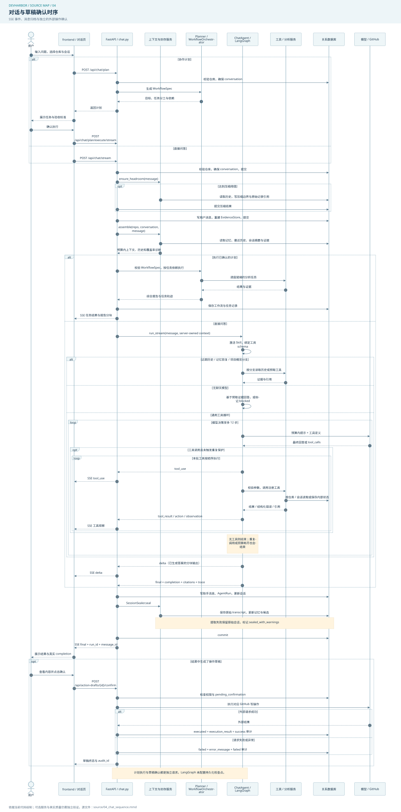
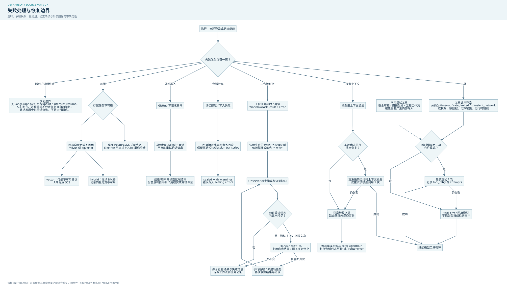
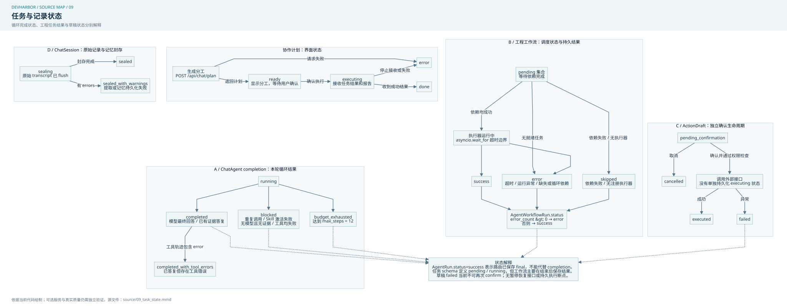

# 运行时序、状态与失败处理

[文档导航](../README.md) · [Agent 工作流](agent_workflow.md) · [数据模型](database_schema.md) · [完整图集](../diagrams/README.md)

这三张图从请求、异常和记录状态观察同一次执行。它们描述当前进程内实现；流式事件与已存储记录不能直接推导出任务可在重启后续跑。

## 一轮对话与独立的草稿确认

[放大 SVG](../diagrams/svg/04_chat_sequence.svg) · [PNG](../diagrams/png/04_chat_sequence.png)

聊天路由先准备范围、上下文和工具，再执行 ChatAgent。回答和工具轨迹随后保存、封存；外部写入通过另一个 ActionDraft 确认请求执行。确认工程计划与确认 GitHub 操作草稿不是同一个动作。

代码入口：[聊天路由](../../backend/app/api/routes/chat.py)、[ChatAgent](../../backend/app/services/agents/chat_agent.py)、[草稿路由](../../backend/app/api/routes/action_drafts.py)。

## 失败分支与恢复边界

[放大 SVG](../diagrams/svg/07_failure_recovery.svg) · [PNG](../diagrams/png/07_failure_recovery.png)

工具的部分暂时性错误允许有限重试，工程任务支持超时、依赖失败传播和有限重规划，检索可以显式降级。这些机制有各自的入口和上限。当前没有持久化任务队列、LangGraph checkpointer、跨进程取消协议或外部操作 exactly-once 保证。

GitHub 请求失败时，本地 `failed` 记录也可能无法证明远端没有产生副作用，应结合远端状态核对。现有代码不会自动完成幂等去重与副作用核实。

代码入口：[编排器](../../backend/app/services/agents/workflow_orchestrator.py)、[检索](../../backend/app/services/rag/retrieval.py)、[草稿确认](../../backend/app/api/routes/action_drafts.py)。

## 三类状态分别解释

[放大 SVG](../diagrams/svg/09_task_state.svg) · [PNG](../diagrams/png/09_task_state.png)

| 状态所在位置 | 应怎样读取 |
| --- | --- |
| `AgentRun.status` 与 SSE 完成事件 | 表示路由运行和输出记录的结果；还需检查 `completion`、工具错误与引用 |
| `WorkflowTaskResult` / `AgentTaskRun` | 区分成功、错误、跳过及具体错误类型；工作流结果还需结合 Observer 与报告 |
| `ActionDraft.status` | 表示草稿确认、取消或执行记录；外部写入成败应结合保存的结果与真实远端状态 |

不能仅用有回答文本、`success` 或 `done` 宣称所有工具成功、可以合并 PR 或模型答案正确。字段与实际失败处理见 [工作流说明](agent_workflow.md) 和 [评估指南](../guides/evaluation.md)。
