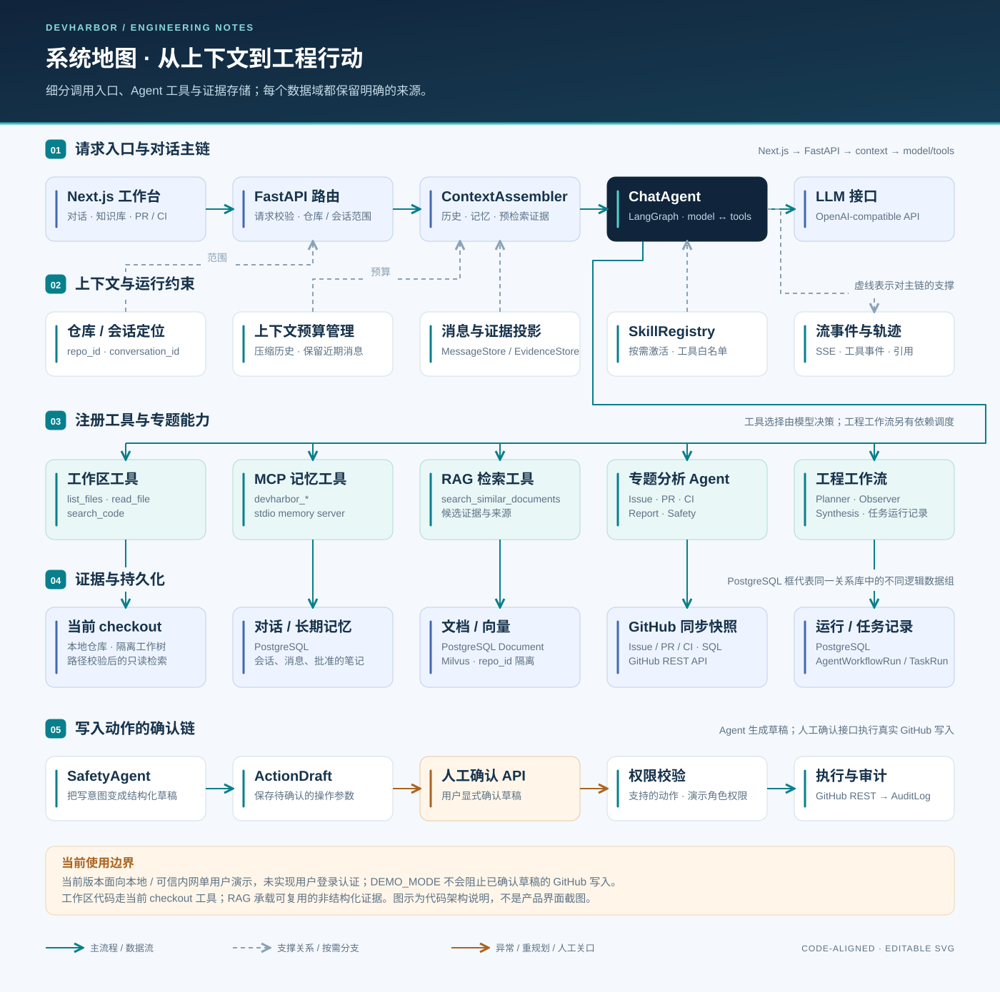

# 系统架构

[返回首页](../../README.md) · [Agent 工作流](agent_workflow.md) · [RAG 流水线](rag_pipeline.md) · [数据模型](database_schema.md)

DevHarbor 将 GitHub 协作数据、本地代码和项目知识接入同一个工程分析工作台。前端负责呈现证据和执行过程；FastAPI 组织数据同步、对话、专项分析、检索与操作草稿。当前部署形态是**单个后端应用 + 前端应用 + 数据服务**，面向本地或受控环境中的单用户演示。

*架构示意图，非运行截图。图中的模块是代码职责边界，并不代表独立部署的微服务。*

## 从一次问题看系统

以“这个 PR 是否具备合并条件”为例：

1. 用户选择仓库与会话；前端将问题发送到 `/api/chat` 或 `/api/chat/stream`。
2. 后端解析仓库与会话，检查上下文余量，保存用户消息，组装历史、结构化记忆和预检索证据。
3. `ChatAgent` 根据问题选择工作区、检索、专项分析或工程工作流工具；工具结果继续进入决策循环。
4. PR 分析读取同步的 PR、文件 diff 和 Review 评论；CI 分析读取同步的运行、Job 和日志；历史知识走 RAG，当前源码走工作区工具。
5. 需要跨领域结论时，由规则规划器构建任务依赖，调度就绪任务，再检查 CI 门禁、证据缺口与跨任务冲突，生成综合意见。
6. 最终回答、工具事件、引用和会话摘要进入关系数据库。对外写入请求先形成 `ActionDraft`，由独立确认接口执行。

GitHub 数据是**最近一次同步的快照**，分析结果不等于持续实时监控。判断“现在是否可合并”时，应先刷新相关数据并核对 GitHub。

## 模块与代码入口

| 模块 | 输入与输出 | 主要实现 |
| --- | --- | --- |
| 页面与 API 客户端 | 仓库、对话、检索配置 → HTTP / SSE；结果 → 页面 | [`frontend/app`](../../frontend/app)、[`frontend/lib/api.ts`](../../frontend/lib/api.ts) |
| API 路由 | Pydantic 请求模型 → 服务调用与响应 | [`app/main.py`](../../backend/app/main.py)、[`api/routes`](../../backend/app/api/routes) |
| GitHub 同步 | 仓库 → Issue / PR / Review / Workflow / Job / 日志快照 | [`repos_sync.py`](../../backend/app/services/repos_sync.py)、[`github`](../../backend/app/services/github) |
| 工作区与项目索引 | checkout → 文件读取、词法搜索、项目文档与符号关系 | [`worktree_manager.py`](../../backend/app/services/worktree_manager.py)、[`project_indexing.py`](../../backend/app/services/project_indexing.py)、[`code_analysis.py`](../../backend/app/services/code_analysis.py) |
| 上下文与记忆 | 会话历史、结构化记忆、证据 → 有预算的模型输入 | [`chat_memory.py`](../../backend/app/services/chat_memory.py)、[`context_compression.py`](../../backend/app/services/context_compression.py) |
| 对话决策 | 模型 tool calls → 工具调用、观察、回答 | [`chat_agent.py`](../../backend/app/services/agents/chat_agent.py) |
| Skill Runtime | `SKILL.md` 与触发条件 → 指令、资源、工具约束与追踪 | [`skills/registry.py`](../../backend/app/services/skills/registry.py)、[`app/skills`](../../backend/app/skills) |
| 工程工作流 | `WorkflowSpec` → 依赖调度、观察结果、综合报告 | [`workflow_orchestrator.py`](../../backend/app/services/agents/workflow_orchestrator.py) |
| RAG | 非结构化文档 → 分块、向量/关键词召回、重排与问答 | [`services/rag`](../../backend/app/services/rag) |
| 操作草稿与审计 | 写入意图 → 草稿 → 确认执行 → 结果与审计 | [`action_drafts.py`](../../backend/app/api/routes/action_drafts.py)、[`permissions.py`](../../backend/app/services/permissions.py) |
| 评测 | 固定题集 → ChatAgent 轨迹、证据、断言与可选 Judge 分数 | [`services/evals`](../../backend/app/services/evals)、[`evaluations.py`](../../backend/app/api/routes/evaluations.py) |

## 三条取证路径

| 问题需要什么 | 取证路径 | 选择原因 |
| --- | --- | --- |
| 当前 checkout 的函数、文件和调用关系 | `workspace.list_files` / `read_file` / `search_code`，代码符号与关系索引 | 当前代码应以实际文件为准；全量源码不进入 RAG |
| Issue / PR / CI 状态、成员、周报等结构化事实 | 对应关系表、服务与 GitHub 同步 | 保持字段语义和对象范围，避免由相似文本推断状态 |
| 历史问题、PR 讨论、失败日志、项目说明与已批准知识 | RAG 文档召回 | 适合跨来源语义检索；召回结果仍是待核对的证据 |

对话记忆还有独立的精确读取路径：三个 `devharbor_*` 工具通过 stdio MCP 调用记忆服务，按仓库和会话范围读取证据、历史及封存的会话事件。MCP 在这里是**内部记忆工具协议**，并非所有工具调用的必经层。

## 数据与基础设施

| 组件 | 保存或提供什么 | 边界 |
| --- | --- | --- |
| PostgreSQL + SQLAlchemy | 业务快照、文档内容与元数据、会话、分析、工作流、草稿和审计 | 本地演示与测试可用 SQLite；不是向量相似度检索后端 |
| Milvus | 带 `repo_id` / `source_type` / `document_id` 的向量记录 | 负责向量检索；Embedding 模型和维度需匹配 |
| etcd + MinIO | Docker Compose 中 Milvus 的依赖 | 不承担应用消息队列职责 |
| 本地文件系统 | 仓库 checkout、上传的原始文档 | 路径由配置管理；工作区读取有边界检查 |
| OpenAI 兼容模型接口 | 对话工具决策及需要模型的分析/生成 | 模型能力依配置而定；没有 Key 时存在本地降级路径 |
| Embedding / Rerank 提供方 | 文本向量与候选重排 | 可选本地 Embedding；确定性向量仅适合测试/演示 |

Compose 使用带 pgvector 扩展的 PostgreSQL 镜像，但当前 `Document` 模型没有向量列，实际向量读写位于 `MilvusVectorStore`。可选 Redis 服务当前也不能作为“已实现分布式任务队列”的证明。

## 工程取舍与当前边界

- **可追踪优先。** 工具调用、观察、引用、压缩诊断与工作流任务分别记录，便于从结论回溯输入和失败位置；这些是应用轨迹，不等同于完整的生产可观测性平台。
- **上下文按用途分配。** 系统信息、记忆、证据、近期消息与工具结果使用不同预算；压力升高时压缩历史，并保留精确恢复入口。Token 数使用估算，不应据此宣称某个未经测量的成本降幅。
- **编排有界。** `ChatAgent` 使用 LangGraph 管理工具循环；工程工作流使用自定义异步调度。Planner、Observer、Synthesis 当前采用规则和结构化逻辑，不能描述成多个模型自由协商。
- **后台任务在应用进程内。** 自动同步、文档处理和评测没有外部持久化队列的重试与故障恢复保证。
- **写入需要确认，但未建立真实登录边界。** 当前权限依赖演示用户，`DEMO_MODE` 也不会自动禁止确认后的 GitHub 写入。部署与操作限制见[安全文档](security.md)。

## 推荐阅读顺序

先看[对话与工程工作流](agent_workflow.md)，再看[RAG 流水线](rag_pipeline.md)中召回、重排和降级的区别；需要追踪数据时查[数据库模型](database_schema.md)。接口以运行中的 `/docs` 与 `/openapi.json` 为准，静态索引见 [API 导航](../api/openapi.md)。启动与依赖配置见[运行指南](../guides/getting-started.md)。
