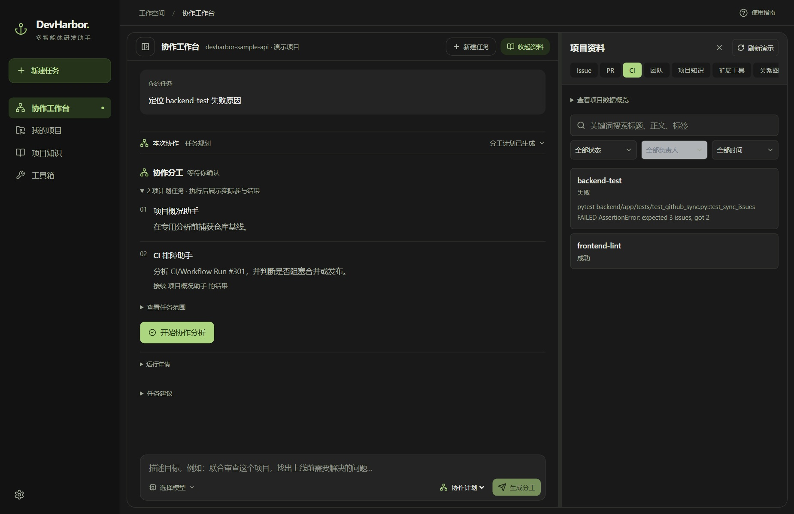
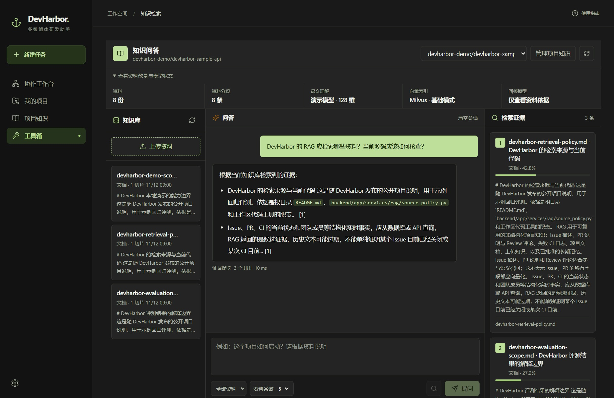

# 演示路线与真实页面

[返回首页](../../README.md) · [运行指南](getting-started.md)

从样例 CI 故障查看协作计划，再通过知识问答核对回答与引用。以下两张截图来自浏览器版的实际运行页面。

## 1. 从 CI 失败进入工作台

运行[本地演示](getting-started.md)，在协作工作台选择 `devharbor-demo/devharbor-sample-api`。打开「项目资料 → CI」，将任务处理方式设为「协作计划」，输入“定位 backend-test 失败原因”并点击「生成分工」。截图停在确认前，显示「项目概况助手」和依赖其结果的「CI 排障助手」，右侧保留两条样例 CI 记录。

这个虚构仓库自带 3 个 Issue、1 个 PR 和 2 条 CI 记录，无需 GitHub Token。工作台将它标为「演示项目」，「刷新演示」只重新读取本地资料。真实仓库的远端同步会访问 GitHub。

点击「开始协作分析」后才会执行工作流。若要跟踪真实模型调用，可配置模型后查看运行详情中的工具与证据。

## 2. 看资料、回答与来源的对应关系

复现步骤：

1. 在“项目知识”中进入同一个样例仓库，上传 [`docs/examples/sources`](../examples/sources) 下全部三个 Markdown 文件，保留原文件名。
2. 等待处理状态变为完成，打开「知识问答」（`/rag`），展开「查看资料数量与模型状态」。
3. 输入“DevHarbor 的 RAG 应检索哪些资料？当前源码应该如何核查？”并点击“提问”。
4. 对照回答中的编号与右侧证据，确认来源文件和摘录是否支持结论。

状态栏显示「演示模型 · 128 维」「Milvus · 基础模式」和「仅查看资料依据」。本次运行使用关键词候选生成摘录式回答。卡片上的百分比是检索分数，页面耗时只记录了这一次请求。

## 3. 用图解释复杂路径

| 展示顺序 | 建议说明 | 深入入口 |
| --- | --- | --- |
| 数据从哪里来 | 当前代码、结构化快照和历史知识使用不同读取路径 | [系统地图](../assets/diagrams/architecture.svg) |
| 复杂问题怎样拆分 | 规则 Planner 生成分工，用户确认后调度就绪任务，Observer 检查结果并按需触发有限重规划 | [工程工作流](../assets/diagrams/agent-workflow.svg) |
| 文档如何变成证据 | 入库、分块、BM25 与可选向量召回、重排、门控与引用 | [RAG 流程](../assets/diagrams/rag-pipeline.svg) |
| 如何证明没有退化 | 对照现有回归测试与固定题集；区分代码通过和真实质量评分 | [评估指南](evaluation.md) |
| 建议怎样变成动作 | 先生成 ActionDraft；确认接口执行真实 GitHub 写入 | [安全边界](../architecture/security.md) |

本地演示没有真实模型时，工程工作流、Skill 和压缩的机制可以通过源码与已有回归测试讲解；不要把静态流程图描述成某次线上运行轨迹。展示真实模型效果时，应使用本人有权公开的仓库，并保留当次模型、检索配置、代码版本和执行记录。

## 截图来源

- 2026-11-12 从 DevHarbor v1.0.1 当前源码运行的浏览器页面采集。
- 数据来自 [seed_demo_data.py](../../scripts/seed_demo_data.py) 的虚构样例和仓库随附的三份公开说明文档。
- 使用独立 SQLite 演示库和 deterministic Embedding。关闭自动同步、Milvus、Hybrid 分数阈值和 RAG 模型生成，使用空 LLM 和 GitHub 凭据。
