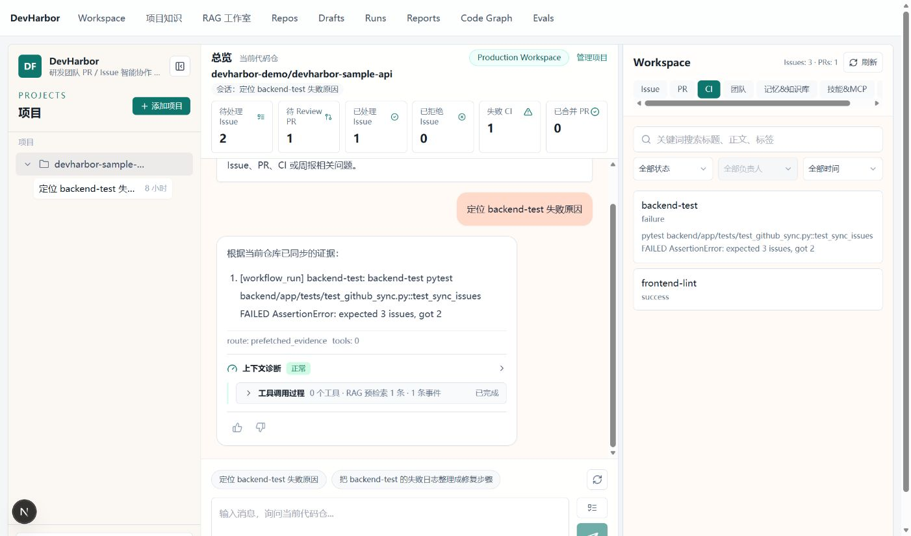
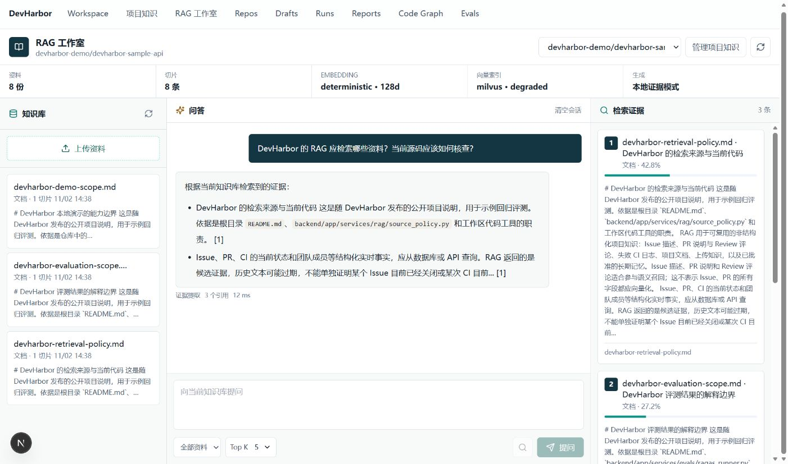

# 演示路线与真实页面

[返回首页](../../README.md) · [运行指南](getting-started.md) · [面试讲解](resume-and-interview.md)

建议用一个具体问题串起展示：先看仓库证据，再看一次分析，最后解释该结论如何产生、如何验证。以下截图来自实际运行页面，不是设计稿。

## 1. 从 CI 失败进入工作台

运行[本地演示](getting-started.md)，选择 `devharbor-demo/devharbor-sample-api`。切到 CI，询问“定位 backend-test 失败原因”，可以看到样例失败日志与回答中的证据。截图中的 `tools: 0` 和 `prefetched_evidence` 表明该次回答走无模型的预检索证据回退路径，不能当成模型调用工具的效果展示。

可以向面试官解释：页面把仓库范围、Issue / PR / CI 快照和会话放在同一个工作台；对话结果旁保留上下文诊断和执行事件。开启真实模型后，需要再展示一次实际工具调用轨迹，才能说明模型如何选工具、补充证据和结束回答。

## 2. 看资料、回答与来源的对应关系

复现步骤：

1. 在“项目知识”中进入同一个样例仓库，上传 [`docs/datas/sources`](../datas/sources) 下全部三个 Markdown 文件，保留原文件名。
2. 等待处理状态变为完成，打开“RAG 工作室”。
3. 输入“DevHarbor 的 RAG 应检索哪些资料？当前源码应该如何核查？”并点击“提问”。
4. 对照回答中的编号与右侧证据，确认来源文件和摘录是否支持结论。

这张截图的状态栏明确显示 `deterministic · 128d`、`milvus · degraded` 与“本地证据模式”。它证明页面、上传解析、关键词检索及引用展示的联动；没有运行真实向量服务或模型生成。卡片上的百分比是检索分数，单次页面耗时是这次演示记录，都不是准确率或性能基准。

## 3. 用图解释复杂路径

| 展示顺序 | 建议说明 | 深入入口 |
| --- | --- | --- |
| 数据从哪里来 | 当前代码、结构化快照和历史知识使用不同读取路径 | [系统地图](../assets/architecture.svg) |
| 复杂问题怎样拆分 | 规则 Planner 建立依赖，调度就绪任务，Observer 检查结果，有限重规划后综合 | [工程工作流](../assets/agent-workflow.svg) |
| 文档如何变成证据 | 入库、分块、向量/关键词候选、融合、重排、门控与引用 | [RAG 流程](../assets/rag-pipeline.svg) |
| 如何证明没有退化 | 对照现有回归测试与固定题集；区分代码通过和真实质量评分 | [评估指南](evaluation.md) |
| 建议怎样变成动作 | 先生成 ActionDraft；确认接口执行真实 GitHub 写入 | [安全边界](../architecture/security.md) |

本地演示没有真实模型时，工程工作流、Skill 和压缩的机制可以通过源码与已有回归测试讲解；不要把静态流程图描述成某次线上运行轨迹。展示真实模型效果时，应使用本人有权公开的仓库，并保留当次模型、检索配置、代码版本和执行记录。

## 截图来源

- 采集日期：2026-11-02；应用版本：v1.0.1。
- 数据来源：[seed_demo_data.py](../../scripts/seed_demo_data.py) 的虚构样例，以及仓库随附的公开说明文档。
- 运行方式：独立 SQLite 预览数据库、关闭自动同步与 Milvus、deterministic Embedding、空 LLM/GitHub 凭据、关闭 RAG 模型生成。Hybrid 的分数阈值关闭，与本地演示脚本一致。
- 截图保留实际页面状态；未修改回答文本、检索分数或状态标签，未执行 GitHub 写入。界面中的 `Production Workspace` 是现有 UI 标签，不代表已经完成生产部署。
- 更新截图时使用独立样例数据，避免把真实凭据、私有仓库内容或他人的个人信息纳入公开图片。
