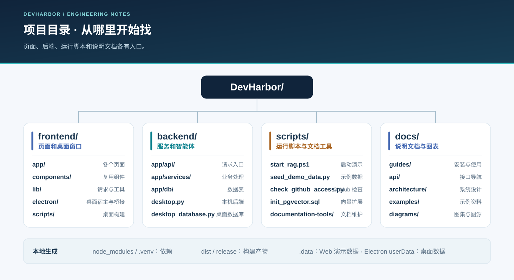

# 项目目录与代码入口

[文档导航](../README.md) · [启动指南](getting-started.md) · [架构导读](../architecture/README.md) · [架构图集](../diagrams/README.md)

改页面看 `frontend/`，找后端逻辑看 `backend/app/`，运行项目脚本看 `scripts/`，阅读设计和使用说明看 `docs/`。桌面版和浏览器版共用 `frontend/app/` 的页面。



[打开目录图 SVG](../assets/diagrams/project-layout.svg) · [查看 Mermaid 源文件](../diagrams/overview/project-layout.mmd)

| 想做什么 | 打开哪里 |
| --- | --- |
| 修改工作台、模型设置或智能体设置 | [页面目录](../../frontend/app/)：例如 [工作台](../../frontend/app/workspace/page.tsx)、[模型设置](../../frontend/app/settings/page.tsx)、[智能体设置](../../frontend/app/settings/agents/page.tsx) |
| 调整页面共用的组件、接口调用或路由 | [组件](../../frontend/components/) · [API 客户端](../../frontend/lib/api.ts) · [路由入口](../../frontend/App.tsx) |
| 查找智能体如何安排和执行任务 | [智能体服务](../../backend/app/services/agents/) · [工作流编排器](../../backend/app/services/agents/workflow_orchestrator.py) |
| 查找文档入库、检索或模型调用 | [RAG 服务](../../backend/app/services/rag/) · [模型调用](../../backend/app/services/llm/) |
| 启动浏览器演示或调试本地桌面进程 | [演示启动脚本](../../scripts/start_rag.ps1) · [Electron 代码](../../frontend/electron/) |
| 查现有用例、补回归测试 | [后端测试](../../backend/app/tests/) · [前端与桌面测试](../../frontend/tests/) |
| 生成图表或检查文档链接 | [文档维护脚本](../../scripts/documentation-tools/) |

## 主要文件怎么放

```text
DevHarbor/
├─ frontend/                      # 浏览器与桌面共用的界面
│  ├─ app/                        # 页面、布局、全局样式
│  ├─ components/                 # 可复用组件
│  ├─ lib/                        # API 客户端、公共类型和辅助逻辑
│  ├─ electron/                   # 桌面窗口、预加载桥、本机后台管理
│  ├─ scripts/                    # 桌面开发和后端冻结打包入口
│  ├─ tests/                      # 前端和桌面运行模块回归
│  ├─ index.html、main.tsx、App.tsx # Vite 页面入口、React 启动与路由
│  └─ package.json、vite.config.ts # 依赖、运行命令和构建配置
├─ backend/
│  ├─ app/
│  │  ├─ main.py                  # FastAPI 入口
│  │  ├─ api/routes/              # 接收请求、返回结果或事件流
│  │  ├─ services/                # Agent、RAG、LLM、GitHub 等业务实现
│  │  ├─ db/、schemas/            # 数据库模型、接口请求与返回结构
│  │  ├─ core/、skills/、mcp/     # 内部配置、安全、技能资料和工具服务
│  │  └─ tests/                   # pytest 用例及测试隔离配置
│  ├─ desktop.py                  # 桌面专用后端入口
│  ├─ devharbor-core.spec          # PyInstaller 后端打包配置
│  └─ requirements*.txt、pyproject.toml
├─ scripts/                       # 从项目层面运行的辅助脚本
│  ├─ start_rag.ps1               # 本地浏览器演示
│  ├─ seed_demo_data.py           # 初始化虚构演示数据
│  ├─ check_github_access.py      # GitHub 访问检查
│  ├─ init_pgvector.sql           # Compose 初始化 PostgreSQL 时加载
│  └─ documentation-tools/        # 生成概览图、详细图和离线浏览页，校验文档
├─ docs/
│  ├─ guides/、architecture/、api/ # 使用指南、系统设计和接口说明
│  ├─ examples/                   # 演示资料和固定评估题集
│  └─ assets/、diagrams/          # 封面、截图、概览图和详细图集
└─ README.md、.env.example、docker-compose.yml 等项目入口与配置
```

新增页面放在 `frontend/app/`，需要独立网址时在 `frontend/App.tsx` 加路由；后端新增接口放在 `backend/app/api/routes/`，实际处理逻辑放在相应的 `services/` 子目录。文档目录里的 `examples/` 包含程序会读取的资料，移动这些文件时也需要检查运行配置。

## 哪些目录平时可以折叠

| 看到什么 | 它的用途 |
| --- | --- |
| `frontend/node_modules/`、`backend/.venv/` | 安装在本机的前端和 Python 依赖，依据依赖清单重建 |
| `frontend/dist/`、`backend/dist/`、`frontend/release/` | 网页构建、冻结的后端和桌面安装包；按需重新生成 |
| `__pycache__/`、`.pytest_cache/`、`*.tsbuildinfo` | Python、测试或 TypeScript 写入的缓存 |
| 根目录 `.data/`、`backend/.data/` | 演示库、仓库检出、上传、日志或恢复备份，位置取决于启动方式和配置；其中的运行数据和备份需要保留 |
| `.git/`、`.github/` | 版本历史、自动检查和依赖更新配置 |

桌面版的默认运行数据在 Electron 的 `userData/backend`，与仓库内的浏览器演示数据分开；位置和备份方法见[桌面运行指南](desktop.md)。

## 常用命令

在项目根目录执行：

```powershell
# 浏览器演示
.\scripts\start_rag.ps1

# 桌面开发预览
npm --prefix frontend run desktop:dev

# 后端回归
Push-Location backend
.\.venv\Scripts\python.exe -m pytest app/tests -q
Pop-Location

# 前端和文档检查
npm --prefix frontend run lint
npm --prefix frontend run build
.\backend\.venv\Scripts\python.exe scripts/documentation-tools/validate_docs.py
```

首次安装和分别启动前后端见[启动指南](getting-started.md)，图表维护见[开发说明](development.md)。
